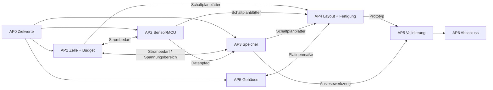

# PLAN – Meilensteine, Zeitplan, Abhängigkeiten

> Bewusst grob. Was genau in einem AP zu tun ist, steht in `docs/ap/`.
> Der aktuelle Stand steht in `STATUS.md`. Grundlage: Pflichtenheft Abschnitt 4.

## Grundsätze

1. **Zielkonflikt zuerst klären.** Abtastrate, Aufzeichnungsdauer, Zelle und Speicher
   hängen voneinander ab und werden bis M1 gemeinsam festgelegt (AP0, AP1, AP2, AP3).
2. **Firmware entsteht parallel zur Leiterplatte** auf dem nRF54L15 DK mit Breakout-Boards,
   damit die Lieferzeit der Platine nicht den Zeitplan bestimmt.
3. **Leiterplatte früh freigeben (M2).** Die Platine ist der kritische Pfad.
4. **Messen statt annehmen.** Strom, Laufzeit und Signalqualität werden gemessen und mit
   dem Budget verglichen.

## Meilensteine und Abschlusskriterien

| MS | Woche | Ergebnis | Erreicht, wenn … |
|---|---|---|---|
| M0 | vor W1 | Freigabe Lasten- und Pflichtenheft | Prof. Cremer hat Lasten- und Pflichtenheft abgenommen; Termine (O7) eingetragen |
| M1 | W2 | Zielwerte hergeleitet, Bauteile ausgewählt | Abtastrate, Auflösung, Messbereich, Aufzeichnungsdauer, Masse und Maße stehen mit Begründung im Pflichtenheft 1.0; für jeden Block gibt es einen ADR mit der Auswahl; O1–O3, O5, O6 geklärt |
| M2 | W4 | Leiterplatte zur Fertigung freigegeben | alle Schaltplanblätter reviewt, ERC/DRC fehlerfrei, BOM mit Bezugsquellen, Fertigungsdaten unter `hardware/production/v1.0/`, bestellt |
| M3 | W7 | Prototyp zeichnet auf und lässt sich auslesen | Prototyp nimmt Daten auf, speichert sie im Flash, überträgt sie per BLE an `tools/readout/`, Export ist lesbar |
| M4 | W9 | Messungen und Praxisaufnahme abgeschlossen | Messprotokolle zu Strom, Laufzeit, Timing und Signalqualität liegen vor; Praxisaufnahme (Zoo oder Testobjekt) mit Videoabgleich durchgeführt |
| M5 | W11 | Abgabe Bericht und Abschlusspräsentation | Projektbericht, Poster/Extended Abstract und Präsentation abgegeben; Repository vollständig |

Termine (Daten) folgen aus O7 und werden in `STATUS.md` und im Lastenheft eingetragen.

## Zeitplan

| Arbeitspaket | W1 | W2 | W3 | W4 | W5 | W6 | W7 | W8 | W9 | W10 | W11 |
|---|---|---|---|---|---|---|---|---|---|---|---|
| AP0 Anforderungen | ■ | ■ | | | | | | | | | |
| AP1 Energie | ■ | ■ | ■ | | ■ | ■ | | ■ | ■ | | |
| AP2 Sensor / MCU | ■ | ■ | ■ | ■ | ■ | ■ | ■ | | | | |
| AP3 Speicher / BLE | ■ | ■ | ■ | ■ | ■ | ■ | ■ | ■ | | | |
| AP4 Leiterplatte | | | ■ | ■ | ■ | ■ | ■ | | | | |
| AP5 Gehäuse / Validierung | | ■ | ■ | ■ | ■ | ■ | | ■ | ■ | ■ | |
| AP6 Abschluss | | | | | | | | | ■ | ■ | ■ |
| **Meilensteine** | | M1 | | M2 | | | M3 | | M4 | | M5 |

## Grobe Phasen

| Phase | Zeitraum | Schwerpunkt |
|---|---|---|
| Spezifikation | bis M1 (W1–W2) | Offene Punkte klären, Budgets rechnen, Bauteile auswählen, erste DK-Versuche |
| Schaltung | M1 → M2 (W3–W4) | Schaltplanblätter je Block, Zusammenführung, Layout, Bestellung; Firmware auf dem DK |
| Prototyp | M2 → M3 (W5–W7) | Firmware vervollständigen, Bestückung, Inbetriebnahme, Gehäuse |
| Validierung | M3 → M4 (W8–W9) | Strom- und Laufzeitmessung, Signalqualität, Praxisaufnahme |
| Abschluss | M4 → M5 (W10–W11) | Bericht, Poster, Präsentation |

## Abhängigkeiten zwischen den APs

Wichtigste Übergaben:

- **AP1 ↔ AP3:** Versorgungsspannungsbereich der Zelle bestimmt die zulässigen Speicher-ICs (Pflichtenheft 3.2); Schreibenergie des Speichers geht ins Energiebudget.
- **AP2 → AP3:** Format der FIFO-Daten und Zeitstempel (Schnittstelle zwischen Sensortreiber und Datenablage), festgehalten in `docs/architecture/datenformat.md`.
- **AP1/AP2/AP3 → AP4:** fertige, reviewte Schaltplanblätter (Vorschlag: spätestens Mitte W3, damit das Layout bis M2 in W4 fertig wird).
- **AP4 ↔ AP5:** Platinenumriss, Zellenhalter und Antennenfreiraum gegen Gehäuse.
