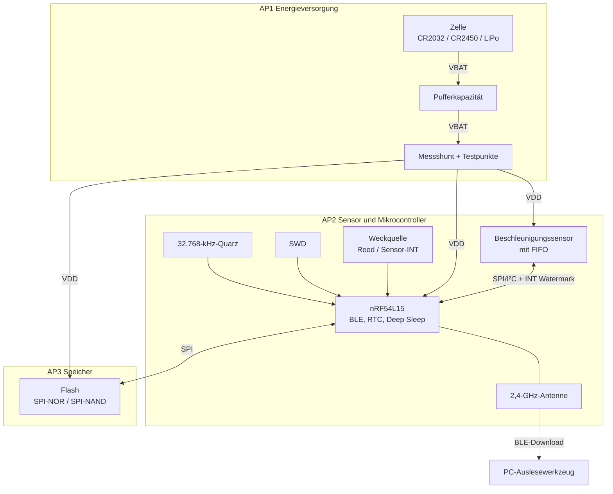
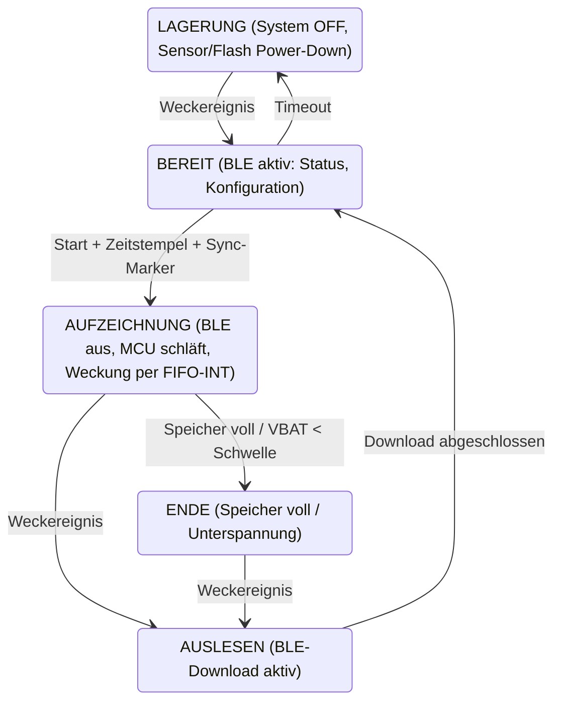

# Systemüberblick

> **Entwurf, nicht bindend.** Die Diagramme entsprechen Abbildung 1 und 2 des
> Pflichtenhefts und zeigen eine mögliche Umsetzung. Wie die Blöcke tatsächlich
> umgesetzt werden, legen die APs fest; Änderungen hier nachziehen und per ADR
> begründen. Für die AP-Zuordnung gilt Pflichtenheft 3.2.1.

## Hardware-Blöcke

## Betriebszustände

## Datenpfad

Sensor-FIFO → Interrupt bei Watermark → Burst-Auslesen in RAM-Puffer → blockweises
Schreiben in den Flash → (nach der Aufnahme) BLE-Download → PC-Werkzeug → Export.

## Pinbelegung

| Signal | nRF54L15-Pin | Block | Festgelegt von |
|---|---|---|---|
| [offen] | | | AP2/AP3/AP1 |
