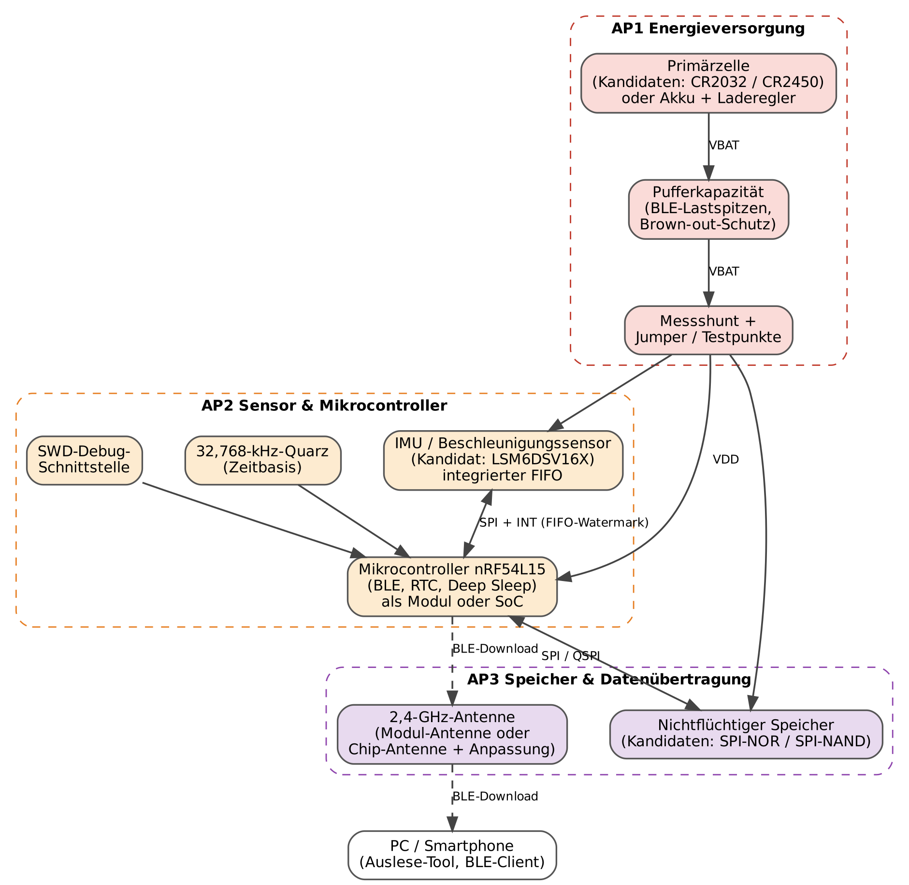
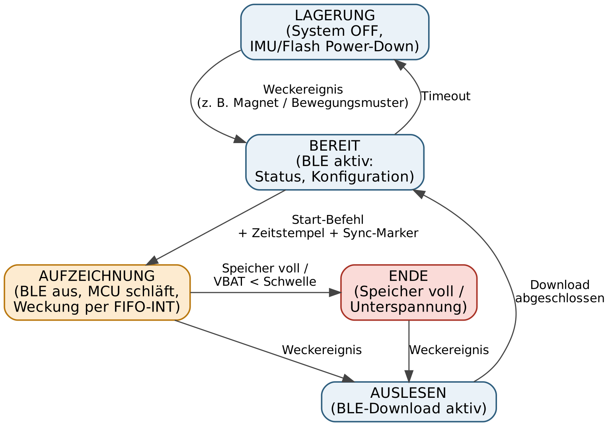

# Pflichtenheft – Miniaturisierter Beschleunigungs-Datenlogger für Tiere

Capstone-Projekt (CAP) · Prof. Dr. Markus Cremer · WS 26/27 · TH Köln\
Version 0.1 (Entwurf) · 17.10.2026\
Erstellt von: Laurenz Untiedt, [Name 2], [Name 3], [Name 4], [Name 5]

## A Änderungsprotokoll

| Version | Änderungen | Datum | Geändert von |
|---|---|---|---|
| 0.1 | Vorläufiges Pflichtenheft auf Basis des Lastenhefts 0.1; Mikrocontroller nRF54L15 festgelegt, übrige Bauteile als Kandidaten | 17.10.2026 | LU |

## C Glossar

| Begriff | Erläuterung |
|---|---|
| ODBA / VeDBA | Overall / Vectorial Dynamic Body Acceleration: Aktivitätsmaße aus der um die Schwerkraft bereinigten Beschleunigung. |
| Gangperiodizität | Wiederkehrendes Beschleunigungsmuster beim Gehen/Laufen, z. B. per Autokorrelation ausgewertet. |
| IMU | Inertial Measurement Unit: Sensor mit Beschleunigungs- (und ggf. Drehraten-)messung. |
| ODR | Output Data Rate: Abtastrate des Sensors. |
| FIFO / Watermark | Zwischenspeicher im Sensor; bei Erreichen eines Füllstands (Watermark) wird ein Interrupt ausgelöst. |
| BLE | Bluetooth Low Energy. |
| NOR- / NAND-Flash | Nichtflüchtige Speicher; NAND bietet mehr Kapazität, erfordert aber Bad-Block-Management. |
| Brown-out | Einbruch der Versorgungsspannung unter die Mindestbetriebsspannung. |
| DK | Development Kit: Entwicklungsboard des Herstellers. |

## 1 Grundlage

Entwickelt wird ein Prototyp eines miniaturisierten, batteriebetriebenen Datenloggers, der die dreiachsige Beschleunigung von Tieren aufzeichnet und die Rohdaten per Bluetooth Low Energy bereitstellt.

Datenbasis:

- Lastenheft „Miniaturisierter Beschleunigungs-Datenlogger für Tiere“, Version 0.1, Stand 17.10.2026 ([lastenheft.md](lastenheft.md))
- Themenbeschreibung „Miniaturised Battery-Powered Acceleration Data Logger for Animal-Borne Field Measurements“, ERTS Lab, Stand Oktober 2026 ([themenbeschreibung.md](themenbeschreibung.md))
- Absprachen mit Prof. Dr. Markus Cremer (E-Mail vom [Datum], Gespräch zur Wahl des Mikrocontrollers)
- Modulhandbuch BaET2020, Modul CAP

> **Stand:** Version 0.1 ist vorläufig. Zielwerte und Bauteile werden bis Meilenstein M1 hergeleitet bzw. ausgewählt und in Version 1.0 eingetragen.

## 2 Einführung

### 2.1 Anforderungen

Es gelten die Anforderungen F1–F11 und NF1–NF6 des Lastenhefts. Die dort offen gelassenen Zielwerte werden in AP0 wie folgt hergeleitet:

| Zielwert | Hergeleitet aus | AP |
|---|---|---|
| Abtastrate, Auflösung, Messbereich | Anforderungen von ODBA/VeDBA und Gangperiodizität, Bewegungsprofil der Tierart, Referenzaufnahmen | AP0, AP2 |
| Aufzeichnungsdauer | Bedarf der geplanten Analysen (O3), Speicher- und Energiebudget (Abschnitt 3.2.2) | AP0, AP1, AP3 |
| Masse und Abmessungen | Tierart und Körpermasse (O1), Befestigung (O2), Größe von Zelle und Platine | AP0, AP5 |

### 2.2 Entwicklungsumgebung

- **Hardware:** KiCad, ein gemeinsames Projekt mit einem Schaltplanblatt je Funktionsblock
- **Firmware:** C mit nRF Connect SDK (Zephyr RTOS) in Visual Studio Code
- **Proof of Concept:** nRF54L15 DK mit Breakout-Boards für Sensor und Speicher, damit die Firmware vor Eintreffen der Leiterplatte entsteht
- **Weitere Werkzeuge:** Python (Auslesen, Auswertung), CAD und 3D-Druck (Gehäuse), Strommesstechnik des Labors, Git auf der GitLab-Instanz der Hochschule

### 2.3 Funktionsbeschreibung

Nach dem Start misst der Sensor mit der gewählten Abtastrate und puffert die Werte in seinem FIFO. Der Mikrocontroller wird nur geweckt, um den FIFO blockweise auszulesen und die Daten gesammelt in den Flash zu schreiben; BLE ist während der Aufnahme aus. Nach der Aufnahme wird das Gerät geweckt und die Daten werden per BLE an ein PC-Werkzeug übertragen, geprüft und exportiert.

### 2.4 Lieferumfang

Gemäß Lastenheft, Abschnitt 7. Quellen und Dokumente liegen im Git-Repository, Dokumente zusätzlich als PDF; die Hardware wird im ERTS Lab übergeben.

### 2.5 Test

Firmware-Funktionen werden zunächst auf dem DK getestet, danach schrittweise am Prototyp im ERTS Lab; die Praxisaufnahme erfolgt im Zoo oder ersatzweise an einem Testobjekt.

| Testgruppe | Inhalt | Anforderungen |
|---|---|---|
| Inbetriebnahme | Sichtprüfung, Smoke-Test am strombegrenzten Netzteil, Programmierung über SWD | – |
| Funktion | Sensor und FIFO-Interrupt, Speicher-Schreib-/Lesetest, BLE-Download mit Vollständigkeitsprüfung | F1–F4, F6, F7, F10 |
| Dauertest | Aufnahme über die Zieldauer; Daten lückenlos, Abtastung gleichmäßig, Zeitbezug korrekt; Datenerhalt nach Spannungsunterbrechung | F5, F8, NF4 |
| Charakterisierung | Strom je Betriebszustand über Messshunt, Laufzeit an der Zelle, Spannungseinbruch bei BLE; Abgleich mit dem Energiebudget | NF3 |
| Validierung | Signalqualität gegenüber Referenzaufnahmen, Masse und Mechanik, Praxisaufnahme mit Videoabgleich | F3, F9, NF1, NF2, NF5 |

### 2.6 Abnahme

Die Abnahme erfolgt mit dem Auftraggeber auf Basis dieser Spezifikation, der Testprotokolle und der Abnahmekriterien des Lastenhefts.

## 3 Implementierung

### 3.1 Mechanisch

Eine kompakte Leiterplatte mit Zellenhalter sitzt in einem 3D-gedruckten Gehäuse mit Befestigung für Halsband oder Geschirr; alternativ wird eine Schutzlackierung bewertet. Der Antennenbereich bleibt frei von Metall, die Achsrichtungen werden außen markiert. Maße und Masse folgen aus Abschnitt 2.1.

### 3.2 Elektrisch

*Abbildung 1: Hardware-Blockdiagramm mit Zuordnung zu den Arbeitspaketen (erster Entwurf, nicht bindend; die Umsetzung legen die APs fest. Maßgeblich für die AP-Zuordnung ist Tabelle 3.2.1.)*

Die Komponenten werden direkt aus der Zelle versorgt, sofern alle Bauteile bis zur Entladeschlussspannung spezifiziert sind; das ist ein Auswahlkriterium für den Speicher. Pufferkapazität gegen Spannungseinbrüche, ein Messshunt und eine SWD-Schnittstelle sind fest vorgesehen.

#### 3.2.1 Bauteilauswahl

Festlegung bis M1 anhand der genannten Kriterien:

| Block | Kandidaten | Kriterien | AP |
|---|---|---|---|
| Mikrocontroller | nRF54L15 (festgelegt) | Abstimmung mit dem Labor | AP2 |
| Antenne | Funkmodul mit integrierter Antenne; SoC mit Chip-Antenne und Anpassnetzwerk | Fläche, HF-Risiko, Zulassungsfrage (O5) | AP2 / AP4 |
| Beschleunigungssensor | LSM6DSV16X (Referenz); reine Beschleunigungssensoren mit FIFO | Strom bei der gewählten ODR, FIFO, Rauschen, Gehäusegröße | AP2 |
| Speicher | SPI-NOR; SPI-NAND | Kapazität (Tabelle 2), Versorgungsspannung, Schreibenergie, Firmware-Aufwand | AP3 |
| Energiespeicher | CR2032 / CR2450; LiPo-Akku mit Laderegler | Kapazität (Tabelle 1), Masse, Pulsbelastbarkeit, Wiederverwendbarkeit | AP1 |
| Pufferung | Kondensatoren, dimensioniert aus gemessenem Pulsstrom | Spannungseinbruch bei BLE, Leckstrom | AP1 |
| Weckmechanismus | Reed-Kontakt (Magnet); Bewegungsmuster über Sensor-Interrupt | Bedienung ohne Öffnen, Bauteilaufwand | AP2 / AP5 |

#### 3.2.2 Energie- und Speicherbudget

Die folgenden Tabellen sind reine Rechnung auf Basis der Themenbeschreibung und zeigen den zentralen Zielkonflikt. Sie legen noch keine Werte fest. (Rechnung reproduzierbar: [`docs/budgets/budget.py`](../budgets/budget.py))

*Tabelle 1: Zulässiger mittlerer Strom je Zelle und Laufzeit (Nennkapazität, ohne Abschläge)*

| Zelle (Nennkapazität) | 24 h | 7 Tage | 30 Tage |
|---|---|---|---|
| CR2032 (ca. 225 mAh) | 9,4 mA | 1,34 mA | 0,31 mA |
| CR2450 (ca. 620 mAh) | 25,8 mA | 3,69 mA | 0,86 mA |

*Tabelle 2: Aufzeichnungsdauer ohne Kompression (3 Achsen × 16 Bit)*

| Speicher | 25 Hz (150 B/s) | 50 Hz (300 B/s) | 100 Hz (600 B/s) |
|---|---|---|---|
| 8 MiB SPI-NOR | 15,5 h | 7,8 h | 3,9 h |
| 32 MiB SPI-NOR | 2,6 Tage | 31,1 h | 15,5 h |
| 128 MiB SPI-NAND | 10,4 Tage | 5,2 Tage | 2,6 Tage |

Ein kleiner NOR-Flash reicht bei 50 Hz für weniger als einen Tag; mehrtägige Aufnahmen erfordern NAND-Flash, eine geringere Abtastrate oder eine Datenreduktion. Diese Abwägung wird in AP1 und AP3 gemeinsam mit den Zielwerten aus Abschnitt 2.1 entschieden.

### 3.3 Firmware

Die Firmware ist in Schichten aufgebaut: Plattform (Zephyr, Hardware-Abstraktion), Treiber (Sensor, Flash, Batteriemessung), Dienste (Datenablage, BLE, Power-Management) und ein Zustandsautomat als Anwendung.

*Abbildung 2: Betriebszustände (erster Entwurf, nicht bindend; die Umsetzung legt AP2 fest)*

- **Datenpfad:** Sensor-FIFO → Interrupt bei Watermark → Burst-Auslesen in einen RAM-Puffer → blockweises Schreiben in den Flash; dazwischen schlafen Mikrocontroller und Flash.
- **Zeitbezug:** Startzeit vom BLE-Client, RTC-Zeitstempel je Datenblock; Sync-Marker über eine definierte Bewegung zu Beginn.
- **Energiesparen:** BLE während der Aufnahme aus, Flash im Power-Down, Weckung nur durch Interrupts.

### 3.4 Schnittstellen

- **Sensor:** SPI oder I²C mit Interrupt-Leitung
- **Speicher:** SPI
- **Debug:** SWD; **Messung:** Shunt mit Testpunkten
- **Extern:** BLE-Service mit Status, Steuerung und Daten-Download; Details in AP3

### 3.5 Benutzeroberfläche

Am Gerät gibt es nur die Weckquelle und ggf. eine Status-LED. Bedient wird über ein PC-Werkzeug (Status, Start, Download, Export). Eine kurze Bedienanleitung für Labor und Tierpflege wird erstellt.

### 3.6 Datenspeicherung

Die Daten werden blockweise mit Zeitstempel und Prüfsumme abgelegt, damit ein Spannungsausfall höchstens den aktuellen Puffer betrifft (NF4). Ob ein einfaches Log oder ein Dateisystem verwendet wird, welches Exportformat entsteht und ob sich Kompression lohnt (F11), wird in AP3 entschieden.

### 3.7 Funktionale Abläufe

1. Gerät wecken, Status prüfen, Uhrzeit übernehmen
2. Anlegen, Aufnahme starten, Sync-Marker vor der Kamera setzen
3. Aufzeichnung bis zum geplanten Ende, vollem Speicher oder Unterspannung
4. Abnehmen, auslesen, exportieren, Speicher löschen

### 3.8 Risiken

| Risiko | Gegenmaßnahme |
|---|---|
| Lieferzeit der Leiterplatte | Layout-Freigabe früh (M2), Firmware parallel auf dem DK |
| Spannungseinbruch der Knopfzelle bei BLE | Pufferung nach Messung dimensionieren, BLE nur im Auslesemodus |
| Speicher reicht nicht für die Zieldauer | Budget bis M1, ggf. NAND, geringere ODR oder Kompression |
| Kein Zugang zum Zoo im Projektzeitraum | Ersatz-Praxistest an einem Testobjekt |

## 4 Arbeitspakete und Meilensteine

### 4.1 Arbeitspakete

Jede Person verantwortet einen Funktionsblock von der Bauteilauswahl über das eigene Schaltplanblatt bis zur zugehörigen Firmware bzw. Validierung. AP4 führt die Schaltplanblätter zusammen und prüft sie.

| AP | Arbeitspaket | Inhalt / Ergebnis | Verantwortlich |
|---|---|---|---|
| AP0 | Anforderungen und Organisation | Offene Punkte klären, Zielwerte herleiten (Abschnitt 2.1), Repository, Zeitplan, Stakeholder-Interview | alle |
| AP1 | Energieversorgung | Zellauswahl, Pufferung, Energiebudget, Schaltplanblatt inkl. Messshunt, Power-Management-Firmware, Strom- und Laufzeitmessung | [Name 1] |
| AP2 | Sensor und Mikrocontroller | Sensor-, Antennen- und Weckauswahl, Schaltplanblatt Digitalteil, Firmware-Basis (Sensortreiber, FIFO, Zeitstempel, Zustandsautomat) | [Name 2] |
| AP3 | Speicher und Datenübertragung | Speicherauswahl, Datenformat, Schaltplanblatt Speicher, Firmware für Datenablage und BLE-Download, PC-Auslesewerkzeug | [Name 3] |
| AP4 | Leiterplatte | Zusammenführung und Review der Schaltplanblätter, Layout, Fertigungsdaten, Bestückung, Inbetriebnahme | Laurenz Untiedt |
| AP5 | Gehäuse und Validierung | Gehäuse und Befestigung, mechanische Tests, Signalqualität, Praxisaufnahme | [Name 5] |
| AP6 | Abschluss | Projektbericht, Poster/Handout oder Extended Abstract, Präsentation | alle |

### 4.2 Zeitplan

Angenommen sind 11 Projektwochen; die Wochen werden an die Termine des Wintersemesters angepasst. Meilensteine siehe Lastenheft, Abschnitt 8.

| Arbeitspaket | W1 | W2 | W3 | W4 | W5 | W6 | W7 | W8 | W9 | W10 | W11 |
|---|---|---|---|---|---|---|---|---|---|---|---|
| AP0 Anforderungen | ■ | ■ | | | | | | | | | |
| AP1 Energie | ■ | ■ | ■ | | ■ | ■ | | ■ | ■ | | |
| AP2 Sensor / MCU | ■ | ■ | ■ | ■ | ■ | ■ | ■ | | | | |
| AP3 Speicher / BLE | ■ | ■ | ■ | ■ | ■ | ■ | ■ | ■ | | | |
| AP4 Leiterplatte | | | ■ | ■ | ■ | ■ | ■ | | | | |
| AP5 Gehäuse / Validierung | | ■ | ■ | ■ | ■ | ■ | | ■ | ■ | ■ | |
| AP6 Abschluss | | | | | | | | | ■ | ■ | ■ |
| **Meilensteine** | | M1 | | M2 | | | M3 | | M4 | | M5 |

## 5 Abnahmeerklärung

Diese Spezifikation ist Bestandteil der Vereinbarung zwischen dem ERTS Lab und dem CAP-Projektteam. Änderungen sind nur schriftlich und mit erhöhter Versionsnummer gültig.

| Rolle | Name | Datum | Unterschrift |
|---|---|---|---|
| Auftraggeber | Prof. Dr. Markus Cremer, ERTS Lab | | |
| Auftragnehmer | CAP-Projektteam | | |
